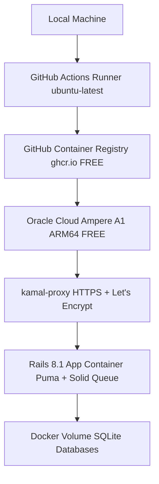
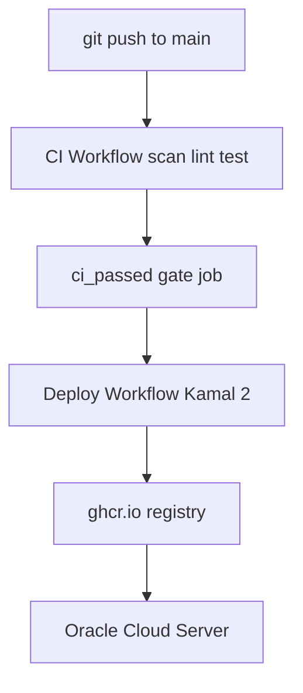

# Kamal 2 Deployment Guide — Oracle Cloud Always Free + GitHub Actions Pipeline

## Architecture Overview



## Why Oracle Cloud Always Free?

| Resource | Free Allocation |
|----------|----------------|
| Compute | 4 OCPU + 24 GB RAM (Ampere A1 ARM64) |
| Block Storage | 200 GB |
| Outbound Transfer | 10 TB/month |
| Cost | **$0 forever** (no expiry, no credit card drain) |

Alternatives considered:
- **Fly.io** — no longer free (2024)
- **Heroku** — no longer free (2022)
- **Render** — free tier sleeps after 15 min inactivity
- **Railway** — credit-based trial only
- **ghcr.io registry** — free for public repos + free private repos on GitHub Free plan

---

## Prerequisites

Install on your local machine:

```bash
# Docker Desktop (for building images)
# https://www.docker.com/products/docker-desktop/

# Kamal 2 (already in Gemfile)
gem install kamal   # or use: bin/kamal

# Verify versions
docker --version     # >= 24.0
bin/kamal version    # >= 2.0
```

---

## Step 1 — Create Oracle Cloud Account

1. Go to **https://www.oracle.com/cloud/free/**
2. Sign up (credit card required for identity verification — you will NOT be charged)
3. Select a **Home Region** close to your users (cannot be changed later)

---

## Step 2 — Create the VM Instance (Ampere A1, ARM64)

In the Oracle Cloud Console:

1. **Compute → Instances → Create Instance**
2. **Name:** `rails8-app`
3. **Image:** Ubuntu 22.04 (Minimal)
4. **Shape:** `VM.Standard.A1.Flex`
   - OCPUs: **4** (use all free allocation)
   - Memory: **24 GB**
5. **Networking:**
   - Create new VCN or use existing
   - Ensure **Assign a public IPv4 address** is checked
6. **SSH Keys:** Upload your public key (`~/.ssh/id_rsa.pub` or `~/.ssh/id_ed25519.pub`)
   ```bash
   # Generate a key if you don't have one
   ssh-keygen -t ed25519 -C "your@email.com"
   cat ~/.ssh/id_ed25519.pub   # copy this into Oracle Cloud
   ```
7. Click **Create**

Note your instance's **Public IP address**.

---

## Step 3 — Open Firewall Ports on Oracle Cloud

Oracle has two firewall layers — both must be configured:

### 3a. Security List (Oracle network firewall)

In the Oracle Console:
1. **Networking → Virtual Cloud Networks → your-vcn → Subnets → public-subnet**
2. **Security List → Default Security List → Add Ingress Rules**

| Protocol | Source CIDR | Destination Port | Purpose |
|----------|-------------|-----------------|---------|
| TCP | 0.0.0.0/0 | 80 | HTTP (redirect to HTTPS) |
| TCP | 0.0.0.0/0 | 443 | HTTPS |
| TCP | 0.0.0.0/0 | 22 | SSH (already exists) |

### 3b. OS-level firewall (iptables on Ubuntu)

SSH into the server and run:

```bash
ssh ubuntu@YOUR_SERVER_IP

# Allow HTTP and HTTPS through Ubuntu's firewall
sudo iptables -I INPUT 6 -m state --state NEW -p tcp --dport 80 -j ACCEPT
sudo iptables -I INPUT 6 -m state --state NEW -p tcp --dport 443 -j ACCEPT
sudo netfilter-persistent save

# Install Docker
curl -fsSL https://get.docker.com | sudo bash
sudo usermod -aG docker ubuntu
# Log out and back in for group to take effect
exit
```

---

## Step 4 — Set Up GitHub Container Registry (ghcr.io)

1. Go to **https://github.com/settings/tokens/new** (classic token)
2. Token name: `kamal-deploy`
3. Scopes: ✅ `write:packages` ✅ `read:packages` ✅ `delete:packages`
4. Click **Generate token** — copy the `ghp_...` token

5. Export credentials in your local shell:

```bash
export KAMAL_REGISTRY_USERNAME="your-github-username"
export KAMAL_REGISTRY_PASSWORD="ghp_your_token_here"

# Add to ~/.zshrc so they persist across terminal sessions
echo 'export KAMAL_REGISTRY_USERNAME="your-github-username"' >> ~/.zshrc
echo 'export KAMAL_REGISTRY_PASSWORD="ghp_your_token_here"' >> ~/.zshrc
```

---

## Step 5 — Configure Your Domain (Optional but Recommended)

For HTTPS with Let's Encrypt you need a domain pointing to your server.

**Free domain options:**
- **Cloudflare** — buy a domain from ~$8/year, free DNS management
- **Freenom** — free `.tk`, `.ml`, `.ga` domains (unreliable)
- **DuckDNS** — free dynamic DNS subdomain (e.g. `yourapp.duckdns.org`)

**DNS Setup:**
```
A record:  yourapp.example.com  →  YOUR_SERVER_IP
```

Wait for DNS to propagate (5–30 min), then verify:
```bash
dig +short yourapp.example.com
# Should return YOUR_SERVER_IP
```

**Without a domain:** comment out the `proxy:` block in `config/deploy.yml` and access the app on `http://YOUR_SERVER_IP` (no HTTPS).

---

## Step 6 — Update config/deploy.yml

Edit `config/deploy.yml` and replace the placeholders:

```yaml
image: YOUR_GITHUB_USERNAME/rails8_app
# ↓ replace with:
image: johndoe/rails8_app

servers:
  web:
    - YOUR_SERVER_IP
# ↓ replace with:
    - 150.230.xxx.xxx

proxy:
  ssl: true
  host: YOUR_DOMAIN
# ↓ replace with:
  host: rails8.example.com
```

---

## Step 7 — First Deploy

```bash
# On your local machine, in the project directory:

# 1. Bootstrap the server (installs Docker, kamal-proxy, sets up volumes)
bin/kamal setup

# 2. If setup fails on first run (proxy not yet installed), try:
bin/kamal server bootstrap

# 3. Deploy the app
bin/kamal deploy

# 4. Tail logs to verify everything started
bin/kamal logs
```

What `kamal setup` does:
1. SSHes into the server as `ubuntu`
2. Installs `kamal-proxy` (handles HTTPS + Let's Encrypt automatically)
3. Pushes your Docker image to ghcr.io
4. Pulls the image on the server
5. Starts the container with the configured volumes and env vars
6. Runs `bin/rails db:prepare` via the entrypoint (creates/migrates SQLite DBs)
7. Configures `kamal-proxy` to route traffic to your container

---

## Step 8 — Subsequent Deploys

After any code change:

```bash
# Commit your changes first
git add -A && git commit -m "your changes"

# Deploy (builds new image, pushes, rolls out zero-downtime)
bin/kamal deploy
```

Zero-downtime deploy flow:
1. Builds new Docker image locally
2. Pushes to ghcr.io
3. Pulls on server
4. Starts new container (health check on `/up`)
5. Switches kamal-proxy to new container
6. Stops old container

---

## Useful Kamal Commands

```bash
# Open Rails console on the server
bin/kamal console

# SSH shell into the container
bin/kamal shell

# Tail live logs
bin/kamal logs

# Check running containers
bin/kamal app containers

# Check kamal-proxy status
bin/kamal proxy status

# Run a one-off command
bin/kamal app exec "bin/rails db:migrate"

# Rollback to previous version
bin/kamal rollback

# View all env vars on server
bin/kamal env show
```

---

## Environment Variables in Production

Secrets are in `.kamal/secrets` (never committed to git).
Clear env vars are in `config/deploy.yml` under `env.clear`.

To add a new secret:
1. Add to `.kamal/secrets`: `MY_SECRET=$MY_SECRET`
2. Add to `config/deploy.yml` under `env.secret`: `- MY_SECRET`
3. Export in your shell: `export MY_SECRET="value"`
4. Redeploy: `bin/kamal deploy`

---

## SQLite in Production

This app uses SQLite with persistent Docker volumes — no external database needed.

The volume `rails8_app_storage:/rails/storage` mounts to `/rails/storage` inside the container, keeping all SQLite files:
- `storage/production.sqlite3` — main database
- `storage/production_queue.sqlite3` — Solid Queue
- `storage/production_cache.sqlite3` — Solid Cache
- `storage/production_cable.sqlite3` — Solid Cable

**Backup your databases:**
```bash
# Download SQLite databases from the server
ssh ubuntu@YOUR_SERVER_IP "docker cp rails8_app-web-1:/rails/storage/production.sqlite3 /tmp/"
scp ubuntu@YOUR_SERVER_IP:/tmp/production.sqlite3 ./backups/
```

---

## Troubleshooting

### App won't start — check logs
```bash
bin/kamal logs --since 30m
bin/kamal app exec "bin/rails runner 'puts Rails.env'"
```

### HTTPS not working — Let's Encrypt issue
```bash
bin/kamal proxy logs
# Verify domain DNS is pointing to server IP
dig +short YOUR_DOMAIN
```

### SSH connection refused
```bash
# Verify Oracle security list has port 22 open
# Verify the SSH user is ubuntu (not root)
ssh -i ~/.ssh/id_ed25519 ubuntu@YOUR_SERVER_IP
```

### Out of memory on ARM instance
```bash
# Check memory usage
bin/kamal app exec "cat /proc/meminfo | head -5"
# SOLID_QUEUE_IN_PUMA=true keeps everything in one process — ideal for single free server
```

### Image won't push to ghcr.io
```bash
# Verify credentials
echo $KAMAL_REGISTRY_PASSWORD | docker login ghcr.io -u $KAMAL_REGISTRY_USERNAME --password-stdin
# Make sure the package visibility is set to public or your PAT has write:packages scope
```

---

## Cost Summary

| Service | Cost |
|---------|------|
| Oracle Cloud Ampere A1 (4 OCPU, 24 GB, always free) | $0 |
| Oracle Cloud block storage 200 GB (always free) | $0 |
| Oracle Cloud egress 10 TB/month (always free) | $0 |
| GitHub Container Registry (free plan) | $0 |
| Let's Encrypt SSL certificates (via kamal-proxy) | $0 |
| **Total** | **$0/month** |

Domain registration is the only optional cost (~$8–12/year if you want a custom domain).

---

## GitHub Actions CI/CD Pipeline

### Pipeline Architecture



### Workflow Files

| File | Purpose |
|------|---------|
| [`.github/workflows/ci.yml`](../.github/workflows/ci.yml) | Runs on every push + PR: security scan, JS audit, RuboCop lint, unit tests, system tests, `ci_passed` gate |
| [`.github/workflows/deploy.yml`](../.github/workflows/deploy.yml) | Runs on push to `main` only: builds ARM64 Docker image, pushes to ghcr.io, deploys via Kamal 2 |

### Step A — Generate a Dedicated Deploy SSH Key

On your local machine, generate a **separate** key just for GitHub Actions (do not reuse your personal key):

```bash
# Generate deploy key (no passphrase — GitHub Actions can't type one)
ssh-keygen -t ed25519 -C "github-actions-deploy" -f ~/.ssh/github_deploy_key -N ""

# Show the public key — add this to the Oracle server
cat ~/.ssh/github_deploy_key.pub

# Show the private key — add this to GitHub Secrets
cat ~/.ssh/github_deploy_key
```

### Step B — Add Public Key to Oracle Server

```bash
# SSH into your Oracle server
ssh ubuntu@YOUR_SERVER_IP

# Append the deploy public key to authorized_keys
echo "ssh-ed25519 AAAA...your-public-key... github-actions-deploy" >> ~/.ssh/authorized_keys
chmod 600 ~/.ssh/authorized_keys
exit
```

### Step C — Add GitHub Repository Secrets

Go to: **GitHub → your repo → Settings → Secrets and variables → Actions → New repository secret**

Add these 4 secrets:

| Secret Name | Value | Where to get it |
|-------------|-------|-----------------|
| `RAILS_MASTER_KEY` | contents of `config/master.key` | `cat config/master.key` |
| `KAMAL_REGISTRY_PASSWORD` | GitHub PAT with `write:packages` scope | https://github.com/settings/tokens |
| `DEPLOY_SSH_PRIVATE_KEY` | contents of `~/.ssh/github_deploy_key` | `cat ~/.ssh/github_deploy_key` |
| `DEPLOY_SERVER_IP` | Oracle instance public IP | Oracle Cloud Console |

### Step D — Create GitHub Repository and Push Code

```bash
# In the project directory on your local machine:

# 1. Create the repo on GitHub (via browser):
#    https://github.com/new
#    Name: rails8_app
#    Visibility: Private or Public
#    Do NOT initialize with README (we have existing code)

# 2. Add remote and push
git remote add origin https://github.com/ram1241/rails8_app.git
git add -A
git commit -m "Initial commit: Rails 8.1 app with Kamal 2 deployment config"
git push -u origin main
```

### Step E — Update deploy.yml URL placeholder

Edit [`.github/workflows/deploy.yml`](../.github/workflows/deploy.yml) line 16:
```yaml
url: https://YOUR_DOMAIN   # Replace with your actual domain
```

### What Happens on Every `git push main`

1. **CI workflow** runs in parallel: security scan, JS audit, RuboCop, unit tests, system tests
2. **`ci_passed` gate job** aggregates all CI results
3. **Deploy workflow** runs (only on `main` push):
   - Sets up QEMU + Docker Buildx for ARM64 cross-compilation
   - Writes SSH private key from `DEPLOY_SSH_PRIVATE_KEY` secret
   - Runs `bin/kamal deploy` → builds ARM64 image → pushes to ghcr.io → SSH deploys to Oracle
   - Zero-downtime: new container health-checked before old one is stopped

### Branch Protection (Optional but Recommended)

In **GitHub → Settings → Branches → Add rule** for `main`:
- ✅ Require status checks to pass: `CI Passed`
- ✅ Require branches to be up to date before merging
- ✅ Require pull request reviews

This ensures no broken code ever reaches production.
